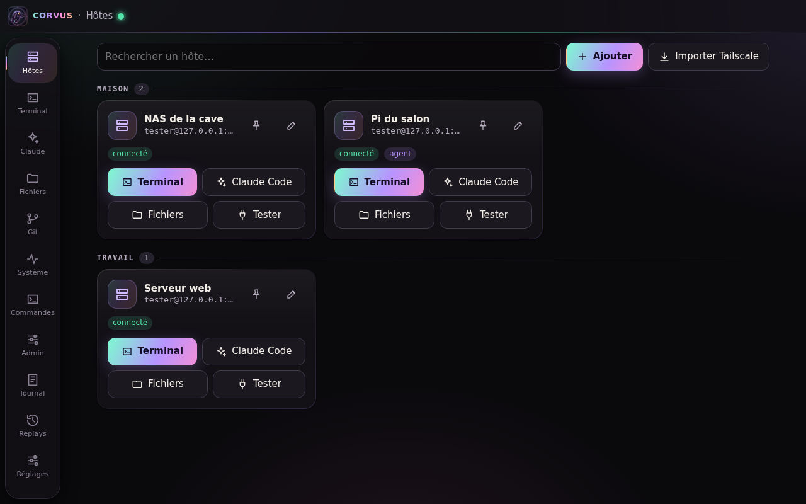
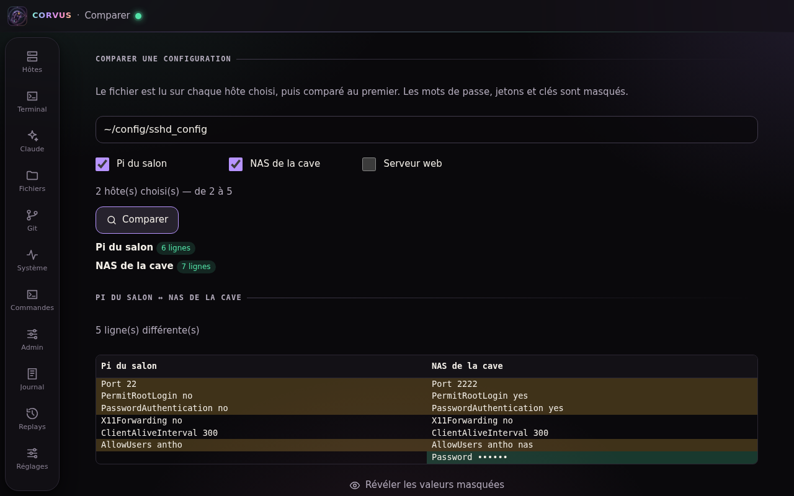

# Corvus

**Votre bastion SSH de poche, et le gardien de vos machines.** 
Terminal, fichiers, git, supervision et défense, depuis le navigateur de votre téléphone, sur votre réseau **Tailscale**. 
Auto-hébergé, gratuit, sans cloud, sans télémétrie, **sans IA**.

**Qualité et sécurité** 

**Projet** 

**Technique et plateformes** 

**Sommaire** : [Installer](#installer) · [Fonctionnalités](#fonctionnalités) · [Sécurité](#sécurité) · [Limites connues](#limites-connues) · [Documentation](#documentation)

## Installer

| Vous voulez… | Commande |
|---|---|
| **Essayer** (Node.js 22.13+) | `git clone https://github.com/spp4tme/Corvus-.git corvus && cd corvus && npm ci && npm start` |
| **Un service** sur Linux / Raspberry Pi | `tar xzf corvus-1.1.0.tar.gz && cd corvus-1.1.0 && sudo ./deploy/install-linux.sh` (archive de la [dernière release](https://github.com/spp4tme/Corvus-/releases/latest)) |
| **Docker** (amd64, arm64) | `docker run -d --name corvus --network host -v corvus-data:/data -e CORVUS_MASTER_PASSPHRASE='une longue phrase' ghcr.io/spp4tme/corvus:1.1.0` |
| **Protéger un hôte** (agent facultatif) | écran *Agents* → « Installer un agent » : une commande à coller (`curl … \| sudo sh -s -- --server … --token …`) |

Corvus n'écoute que sur `127.0.0.1:7680` ; un token s'affiche au premier lancement pour créer le compte administrateur.
**Ne l'exposez jamais sur Internet** : publiez-le sur votre tailnet avec `tailscale serve`
([pas à pas](https://github.com/spp4tme/Corvus-/wiki/Tailscale-et-PWA)). **Définissez une passphrase maître**
(`CORVUS_MASTER_PASSPHRASE`) : sans elle, copier le dossier de données suffit à lire les secrets de vos hôtes.

## Fonctionnalités

- **Terminal, fichiers (SFTP), git, supervision, Docker** sur vos machines, en SSH, avec une interface pensée d'abord pour le
  téléphone (PWA installable).
- **Comptes** : TOTP obligatoire, passkeys, rôles (lecteur, opérateur, administrateur), droits par hôte, jetons d'API,
  journal d'audit à chaînage cryptographique (toute modification est détectable).
- **Défense avec l'agent** (Rust, 3 Mo, aucun port ouvert sur l'hôte) : **Rembobiner** les fichiers, **prévisualiser** une commande
  risquée dans un bac à sable, **radiographier** les processus, repérer l'inhabituel, bloquer un **ransomware** (fichiers pièges,
  isolement réseau).
- Règles et statistiques, **jamais d'IA**. Toute action destructive demande une confirmation et laisse une trace.

**Nouveau en 1.1**

| | |
|---|---|
| **Comparer** | un fichier de configuration lu sur 2 à 5 hôtes, différences côte à côte, mots de passe et clés masqués |
| **Replay** | recherche plein texte dans une ou toutes vos sessions enregistrées, saut à l'instant trouvé, export `.cast` |
| **Notifications** | boutons *Ouvrir*, *Acquitter* et *Isoler…* (qui ouvre l'écran de confirmation, sans jamais isoler d'un seul geste) |
| **Copie d'hôte à hôte** | fichier ou dossier d'un hôte à l'autre, en flux, avec progression, annulation sans résidu, jamais d'écrasement sans confirmation |
| **Partager vers Corvus** | envoyer une photo ou un fichier depuis le menu Partager (Android, ordinateur) ; **iPhone : voir [Limites connues](#limites-connues)** |

## Sécurité

Corvus donne un accès shell à vos machines : la sécurité prime sur le reste. Garde-fous principaux :

- **jamais sur Internet** (écoute locale, refus d'une adresse publique, HTTPS par `tailscale serve`) ;
- **authentification forte** : mot de passe + TOTP (ou passkey), essais limités par IP et par compte, sessions révocables ;
- **droits à deux niveaux** : un contrôle central **et** une seconde barrière dans chaque routeur ; un hôte non accordé est invisible (404) ;
  un jeton d'API ne peut créer ni jeton, ni passkey, ni compte ;
- **secrets chiffrés** (AES-256-GCM) ; **avec une passphrase maître**, voler le dossier de données ne suffit pas — Corvus
  vous avertit tant qu'elle manque (installation, bandeau, réglages) ;
- **journal d'audit** chaîné par SHA-256 : notez son empreinte de tête (`sudo corvus journal-head`) hors du serveur ;
- **agent sans commande shell** : seulement des actions nommées et validées, avec authentification mutuelle Ed25519.

Signalement d'une vulnérabilité : **[SECURITY.md](SECURITY.md)** (signalement privé via GitHub Security Advisories). Détails :
[modèle de menace](docs/modele-de-menace.md), [audit 1.1.0](docs/audit-1.1.0.md) (ce qui a été trouvé, corrigé, et ce qui reste
ouvert), [sécurité](docs/securite.md).

## Limites connues

Corvus dit ce qu'il n'a pas validé : voir le [journal des essais réels](docs/suite-pi.md) et la
[page du wiki](https://github.com/spp4tme/Corvus-/wiki/Limites-connues). À retenir :

- **iPhone et « Partager vers Corvus »** : Safari ne permet pas à une application web de recevoir un partage. Sur iPhone, utilisez un
  **Raccourci Apple** qui envoie le fichier à l'API avec un jeton personnel
  ([pas à pas](https://github.com/spp4tme/Corvus-/wiki/Raccourci-iPhone)). Sur Android et ordinateur (application installée), le menu
  Partager fonctionne ; il n'a pas encore été essayé sur un vrai téléphone.
- **Un « lecteur » lit tout ce que le compte SSH de l'hôte peut lire** (fichiers, processus, journaux Docker, dépôts git).
- **Jetons d'API** : sans expiration ni portée ; à révoquer dès qu'ils ont servi.
- **Isolement réseau** : validé avec une liaison Tailscale directe seulement ; testez d'abord sur un hôte non critique.
- Pas d'eBPF (fanotify avec les droits complets), pas de certificats SSH courts, pas de rebond SSH.

## Documentation

Tout est dans le **[wiki](https://github.com/spp4tme/Corvus-/wiki)** : [démarrage rapide](https://github.com/spp4tme/Corvus-/wiki/Demarrage-rapide),
[installation Linux](https://github.com/spp4tme/Corvus-/wiki/Installation-Linux), [Docker](https://github.com/spp4tme/Corvus-/wiki/Installation-Docker),
[configuration](https://github.com/spp4tme/Corvus-/wiki/Configuration), [sécurité](https://github.com/spp4tme/Corvus-/wiki/Securite),
[l'agent](https://github.com/spp4tme/Corvus-/wiki/Agent-vue-d-ensemble), [API](https://github.com/spp4tme/Corvus-/wiki/API),
[dépannage](https://github.com/spp4tme/Corvus-/wiki/Depannage), [contribuer](https://github.com/spp4tme/Corvus-/wiki/Contribuer).

Dans le dépôt : [CHANGELOG](CHANGELOG.md) · [protocole de l'agent](docs/protocole-agent.md) · [sécurité](docs/securite.md) ·
[notifications](docs/notifications.md) · [validations réelles](docs/suite-pi.md).

---

Licence : MIT. Corvus est un projet indépendant : nom, logo et interface originaux.
