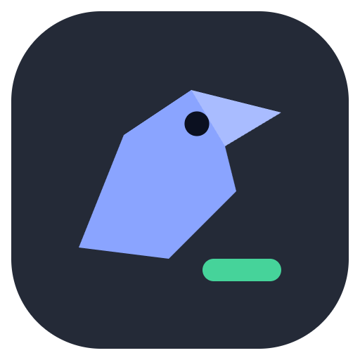

# Corvus

**Votre bastion SSH de poche, et le gardien de vos machines.** 
Terminal, fichiers, git, supervision et défense, depuis le navigateur de votre téléphone, sur votre réseau **Tailscale**. 
Auto-hébergé, gratuit, sans cloud, sans télémétrie, **sans IA**.

## Installer

| Vous voulez… | Commande |
|---|---|
| **Essayer** (Node.js 22.13+) | `git clone https://github.com/spp4tme/Corvus-.git corvus && cd corvus && npm ci && npm start` |
| **Un service** sur Linux / Raspberry Pi | `tar xzf corvus-*.tar.gz && cd corvus-* && sudo ./deploy/install-linux.sh` (archive de la [dernière release](https://github.com/spp4tme/Corvus-/releases/latest)) |
| **Docker** (amd64, arm64) | `docker run -d --name corvus --network host -v corvus-data:/data ghcr.io/spp4tme/corvus:latest` |

Corvus n'écoute que sur `127.0.0.1:7680`. Au premier lancement, un token s'affiche : il sert à créer le compte administrateur.
**Ne l'exposez jamais sur Internet** : utilisez `tailscale serve` ([comment](https://github.com/spp4tme/Corvus-/wiki/Tailscale-et-PWA)).

## Ce que fait Corvus

- **Terminal, fichiers, git, supervision, Docker** sur vos machines, en SSH, avec une interface pensée d'abord pour le téléphone (PWA).
- **Comptes** avec TOTP obligatoire, passkeys, rôles, droits par hôte, journal d'audit à chaînage cryptographique (toute modification est détectable).
- **Défense avec l'agent facultatif** (Rust, 3 Mo, aucun port ouvert sur l'hôte) : **Rembobiner** les fichiers, **prévisualiser** une
  commande risquée, **radiographier** les processus, repérer l'inhabituel, bloquer un **ransomware**.
- Règles et statistiques, **jamais d'IA**. Toute action destructive demande une confirmation et laisse une trace.

## Documentation

Tout est dans le **[wiki](https://github.com/spp4tme/Corvus-/wiki)** :

| | |
|---|---|
| [Démarrage rapide](https://github.com/spp4tme/Corvus-/wiki/Demarrage-rapide) | [Installation Linux](https://github.com/spp4tme/Corvus-/wiki/Installation-Linux) · [Docker](https://github.com/spp4tme/Corvus-/wiki/Installation-Docker) · [Windows et macOS](https://github.com/spp4tme/Corvus-/wiki/Installation-Windows-et-macOS) |
| [Configuration](https://github.com/spp4tme/Corvus-/wiki/Configuration) | [Sécurité](https://github.com/spp4tme/Corvus-/wiki/Securite) · [L'agent](https://github.com/spp4tme/Corvus-/wiki/Agent-vue-d-ensemble) · [Dépannage](https://github.com/spp4tme/Corvus-/wiki/Depannage) |
| [Limites connues](https://github.com/spp4tme/Corvus-/wiki/Limites-connues) | [Contribuer](https://github.com/spp4tme/Corvus-/wiki/Contribuer) · [Changelog](CHANGELOG.md) |

Documents techniques du dépôt : [protocole de l'agent](docs/protocole-agent.md), [sécurité](docs/securite.md),
[notifications](docs/notifications.md), [validations réelles](docs/suite-pi.md).

---

Licence : MIT. Corvus est un projet indépendant : nom, logo et interface originaux.
